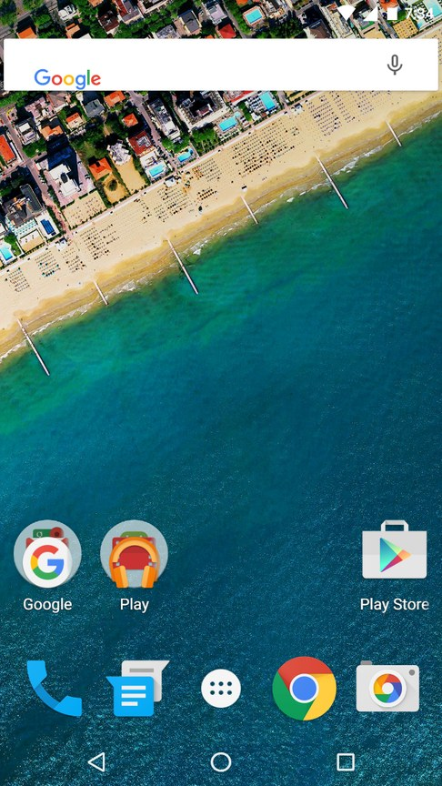
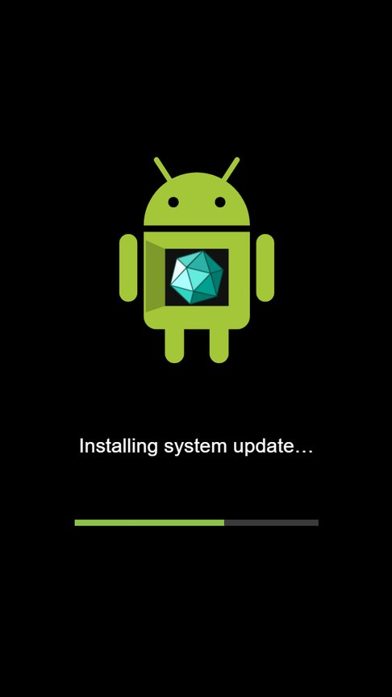

# Android Time Machine


**Live demo:** [android.levente.net](https://android.levente.net/) · mirror on [GitHub Pages](https://szabolevi98.github.io/android-time-machine/)

An interactive browser simulator of classic Android releases, each on its own Nexus phone and rebuilt from AOSP
sources, the phones' factory images and period screenshots. Choose a version on the landing page.

## Versions

Each version links to what it does, screen by screen (for 2.3.6, its visual audit).

| Version | Year | Phone | Build |
| --- | --- | --- | --- |
| [Android 2.1 Eclair](docs/features/2.1.md) | 2010 | Nexus One | ERE27 |
| [Android 2.3.6 Gingerbread](docs/audits/2.3.6.md) | 2011 | Nexus S | GRK39F |
| [Android 4.0.4 Ice Cream Sandwich](docs/features/4.0.4.md) | 2012 | Galaxy Nexus | IMM76I |
| [Android 4.3 Jelly Bean](docs/features/4.3.md) | 2013 | Nexus 4 | JWR66Y |
| [Android 4.4.4 KitKat](docs/features/4.4.4.md) | 2014 | Nexus 5 | KTU84P |
| [Android 5.1.1 Lollipop](docs/features/5.1.1.md) | 2015 | Nexus 6 | LMY48Y |
| [Android 6.0.1 Marshmallow](docs/features/6.0.1.md) | 2016 | Nexus 5X | MTC20K |
| [Android 7.1.2 Nougat](docs/features/7.1.2.md) | 2017 | Nexus 6P | N2G48C |

Every version runs the apps its factory image ships, Google's apps included. 6.0.1 and 7.1.2 also have the period
Google apps their image lacks, shown as installed from Play.

<table>
  <tr>
    <td align="center"><br>2.1</td>
    <td align="center"><br>2.3.6</td>
    <td align="center"><br>4.0.4</td>
    <td align="center"><br>4.3</td>
  </tr>
  <tr>
    <td align="center"><br>4.4.4</td>
    <td align="center"><br>5.1.1</td>
    <td align="center"><br>6.0.1</td>
    <td align="center"><br>7.1.2</td>
  </tr>
</table>

## What you can do

- Boot the phone, unlock it and use it: the launcher with folders, widgets and drag and drop, the notification shade,
  Settings, and the period apps (dialer, messages, contacts, camera, gallery, browser, mail, store and more).
- Try each release's signature features and its easter egg, from the Nexus One's 3D app drawer to Nougat's
  split-screen.
- Start from a phone someone already uses: the same contacts, conversations, appointments and photos in every version.
- Switch the interface between English, Hungarian, German, French and Spanish.
- Use the hardware keys above the phone (volume, power, full screen) and reset a version's data.
- Everything you change is saved in the browser, separately for each version.
- Play it on a desktop with the mouse, or on a phone, where the simulator fills the screen and takes touch input.

## Running locally

The project is static HTML, CSS and JavaScript, with no installation or build step. Start a local server from the
project root:

```bash
php -S 127.0.0.1:8090 -t .
```

Then visit `http://127.0.0.1:8090/`. With XAMPP, place the repository in `htdocs/android-time-machine`.

## Checks

Module tests use Node.js. Nougat's Photos pixel fixtures also require Python and Pillow (the CI installs the same
pinned version):

```bash
python -m pip install -r .github/requirements-tests.txt
npm test
```

The browser flows open each version in headless Chrome (boot, unlock, an app, Back, the power menu, a language switch
and a reload, at desktop and phone width) against a server for the repository root, e.g. `php -S localhost:8090 -t .`.
Nougat's release gate also checks fresh demo data, old saves, every launcher app and every extracted preference screen
in five languages; its detailed integration flows live in `tests/browser/ng-*.mjs`. Wallpaper regressions also check
real mouse dragging, wheel scrolling, selection and phone touch in 5.1.1, 6.0.1 and 7.1.2:

```bash
npm run test:browser
```

Both run on every push (`.github/workflows/tests.yml`). The text, asset and font checks (`npm run check:texts`,
`check:assets`, `check:fonts`) write their reports to `docs/reports/`.

## Development

- [docs/architecture.md](docs/architecture.md): how the code is laid out and where to change an app
- [docs/sources.md](docs/sources.md): how the factory images are unpacked and the generated files rebuilt
- [docs/saved-state.md](docs/saved-state.md) and [docs/demo-data.md](docs/demo-data.md): what a save holds, and the
  shared demo content
- [docs/maintenance.md](docs/maintenance.md): publishing, cache-busting, social preview images, the sitemap and adding
  a version

Everything else (feature lists, visual audits, plans, tools) is indexed in [docs/README.md](docs/README.md).

## License

Copyright © 2026 Levente Szabó (szabolevi98).

The project's original source code is licensed under the **GNU Affero General Public License, Version 3 only** (`AGPL-3.0-only`). See [LICENSE](LICENSE) for the full terms.

If you make a modified version available to users over a network, you must prominently offer those users free access to that version's complete corresponding source code, as required by section 13. The source code is available in this [repository](https://github.com/szabolevi98/android-time-machine).

Third-party code, artwork, fonts and other assets remain subject to their own licenses and terms; they are not relicensed under the AGPL. See [THIRD_PARTY_NOTICES.md](THIRD_PARTY_NOTICES.md). Android and Google trademarks remain with their respective owners.
